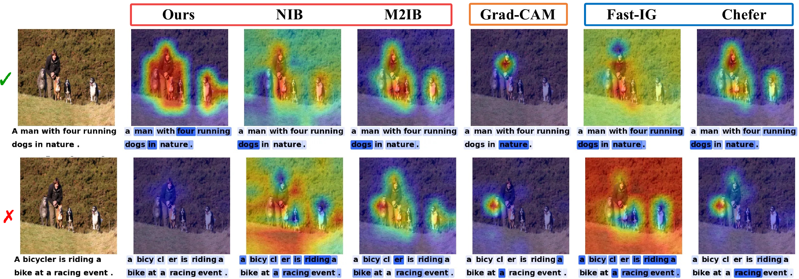

# TIB: Sample-wise Tempered Information Bottleneck for Multimodal Attribution beyond Alignment Assumption

**Accepted at NeurIPS 2026.**

[MIx Group](https://mix.jianbojiao.com/), University of Birmingham

**Authors:** [Qiming Huang](https://qiming-huang.github.io/), Peixi Liu, [Jianbo Jiao](https://jianbojiao.com/)
**Project page:** TBD

TIB explains image–text models by adapting attribution strength to cross-modal reliability, allowing for semantic misalignment between paired inputs. This repository contains the standalone TIB implementation with CLIP and fixed-grid SigLIP backbones.



## Installation

Requires Python 3.10+. Install from the repository root:

```bash
python -m pip install -e .
```

## Quick Start

Run from the repository root. Replace the image path and caption with your own inputs.

```python
from PIL import Image
from tib_attribution import explain, load_backbone, load_branch_configs

model_name = "openai/clip-vit-base-patch32"
backbone = load_backbone(model_name)
configs = load_branch_configs("configs/tib_clip_b32.json", model=model_name)
image = Image.open("your_image.jpg").convert("RGB")
inputs = backbone.processor(
    text=["a cat and a dog"], images=image, return_tensors="pt", padding=True,
)
result = explain(backbone, inputs, branch_configs=configs)
result.save("attribution.npz")
```

Each call explains one image–text pair and returns image and token scores, masks, and predicted variances. The backbone weights remain frozen. Model weights download on first use; pass `local_files_only=True` to `load_backbone` to use cached weights.

## Citation

```bibtex
@inproceedings{huang2026tib,
  title     = {{TIB}: Sample-wise Tempered Information Bottleneck for Multimodal Attribution beyond Alignment Assumption},
  author    = {Qiming Huang and Peixi Liu and Jianbo Jiao},
  booktitle = {Advances in Neural Information Processing Systems},
  year      = {2026}
}
```
